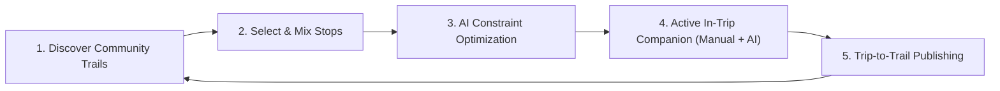

# TRAILWEAVE

## DETAILED PRODUCT REQUIREMENTS DOCUMENT (PRD v3.0)
### Community-Powered Travel Discovery | Active In-Trip Companion | Constraint-Aware AI Journeys | Inclusive Local Tourism

| **DOCUMENT** | **DETAIL** |
| :--- | :--- |
| **Version** | 3.0 — Comprehensive Community & Active Companion Baseline |
| **Prepared** | 12 October 2026 |
| **Event** | Aravalli Build Championship: Road to DevFest Udaipur |
| **Domain** | Heritage, Tourism & Sustainable Hospitality |
| **Hackathon Dates** | 31 October – 1 November 2026 |
| **Geographic Pilot** | Udaipur, Rajasthan, India |
| **Delivery Model** | Unified Mobile-First PWA (Next.js/Tailwind) + Python FastAPI + Supabase PostGIS + WhatsApp Channel |
| **Status** | Approved, implementation-ready product specification |

> **"TrailWeave — Explore like a local. Travel your way. Pass it on."**  
> *TrailWeave transforms real travelers' experiences into personalized, actionable journeys while providing an intelligent active in-trip companion and opening discovery opportunities for local artisans and small businesses.*

---

# Document Guide

This document consolidates the complete product specification, incorporating all decisions from `flows.md`, `FairPath_Changes_Since_Trip_to_Trail_Spec.md`, and Architecture Decision Records (ADR 0001–0006).

| **SECTION** | **WHAT IT DEFINES** |
| :--- | :--- |
| **01–03** | Product Vision, Community Flywheel, Personas & Jobs to be Done |
| **04–06** | Scope (P0/P1/P2), Primary User Journeys & Functional Requirements |
| **07–09** | Unified Mutation Engine, Single Source of Truth, Scheduling & AI Tool Architecture |
| **10–11** | Database Schema (PostgreSQL + PostGIS), REST API Contracts & Gemini Function Calling |
| **12–13** | Non-Functional Requirements, Content Trust, Privacy & Concurrency Safeguards |
| **14–16** | Analytics Framework, 48-Hour Hackathon Demo Script, Test Matrix & Definition of Done |

---

# 1. Product Vision & Community Strategy

## 1.1 The Community Travel Flywheel
TrailWeave eliminates reliance on external social media influencer recruitment by creating a self-sustaining **Community Knowledge Loop**:



1. **Discover**: Tourists explore authentic, completed itineraries published by fellow travelers and local residents.
2. **Select & Mix**: Tourists adopt a complete community trail or hand-pick individual stops across multiple trails into a personal Trip Basket.
3. **Personalize**: The deterministic planning engine optimizes the route under hard budget, time, and operating-hour constraints.
4. **Active In-Trip Companion**: During travel, tourists follow live navigation, receive personalized transition notifications, and seamlessly adapt the journey—either through direct manual controls or by asking the Gemini AI companion. Both interfaces mutate the **same authoritative database state**.
5. **Share (Trip-to-Trail)**: At trip completion, tourists confirm which places they actually visited and convert their real-world journey into an editable, published Community Trail.
6. **Pass it on**: Future tourists discover, clone, and remix that trail.

## 1.2 Core Product Principles
1. **Community First, Not Influencer First**: Professional creators remain welcome as one type of curator, but every traveler can become a curator without needing a social media following.
2. **Single Authoritative Source of Truth**: PostgreSQL/Supabase holds the canonical accepted trip state and revision history. Neither React state nor LLM chat memory is authoritative.
3. **Unified Mutation Pathway**: Direct manual edits (dragging, skipping, adding stops) and natural language requests to the AI companion execute through the exact same authorized FastAPI Trip Engine.
4. **No Blank-Page Content Creation**: Travelers never write guides from scratch. Confirmed, completed trip records form the immediate foundation for a new community trail draft.
5. **Flexible Discovery & Stop Mixing**: Users are never locked into an all-or-nothing trail; they can combine favorite stops from multiple travelers.
6. **Inspiration vs. Feasible Route**: A community trail provides inspiration; the AI planner must re-validate the schedule against the *new* traveler's specific start point, hours, and budget.
7. **TrailWeave Artisan Inclusion**: Local craftsmen (miniature painters, potters, weavers) are surfaced via transparent, budget-respecting recommendations, not buried in an obscure sub-directory.
8. **Private by Default**: Personal trip details (hotels, exact GPS history, private expenses) are strictly private; only user-approved public fields are published.
9. **Deterministic Feasibility**: Hard limits (time, budget, hours) are evaluated mathematically by the backend, never hallucinated by an LLM.

---

# 2. Objectives, Outcomes & Non-Goals

## 2.1 Success Metrics
- **North-Star Metric**: Number of community trails reused to create journeys that users later report completing.
- **Feasibility Rate**: 100% of generated itineraries pass hard budget, transit, and open/close constraints.
- **Active Trip Modification Success**: Both manual edits and AI-requested modifications preview before/after diffs and commit with 0% data corruption via revision locking.
- **Artisan Discovery Uptake**: At least 30% of generated itineraries surface a relevant, budget-compliant artisan workshop with demonstrated tourist accept/reject agency.
- **Voice Onboarding Accessibility**: 100% of scripted Hindi voice notes yield reviewable, structured artisan drafts via WhatsApp.

## 2.2 Exclusions from Hackathon Scope (Non-Goals)
- Scraping arbitrary Instagram Reels or TikTok videos.
- Direct payment gateways, hotel/flight booking engines, or commission settlements.
- Native turn-by-turn navigation engine (deep linking into native Google Maps satisfies navigation).
- Complex social features (follow graphs, direct messaging, comment wars).
- Model Context Protocol (MCP) server as a hard requirement (native Gemini function calling is used for MVP; MCP is an optional future adapter).
- Nationwide expansion (Udaipur remains the exclusive pilot city).

---

# 3. Personas & Access Roles (RBAC)

TrailWeave operates on a 3-role access model:

| Role | Persona | Job to be Done | Surfaces |
| :--- | :--- | :--- | :--- |
| **`tourist`** | **Traveler & Community Curator** | Discover real Udaipur itineraries, personalize routes within budget, navigate live via the Active Companion, adapt plans manually or via AI, and share completed trips as community trails. | Mobile PWA (Home, Explorer, Trip Builder, Active Trip, Trip-to-Trail) |
| **`artisan`** | **Local Craftsman** | Get physical store/workshop discovered by cultural tourists without learning complex apps or paying high directory fees. | WhatsApp Channel (Hindi Voice/Text) + Mobile Confirmation Link |
| **`admin`** | **Curator & System Admin** | Verify place data, review & publish artisan drafts, curate community-submitted trails, and control demo simulations. | Mobile/Desktop Admin Portal (`/admin`) |

*Note*: Professional travel creators participate under the `tourist` role with an optional verified "Creator" profile badge.

---

# 4. Scope by Priority (P0 / P1 / P2)

| Module | P0 — Hackathon Must-Demo | P1 — Secondary If Stable | P2 — Future Roadmap |
| :--- | :--- | :--- | :--- |
| **Community Discovery** | Community-first homepage, featured trails, category filters (Heritage, Food, Crafts), Trail Explorer, detailed stop cards. | Advanced keyword search, curator badges. | Follower feeds, social comments. |
| **Trail Mixing** | "Use as Base", "Add All Stops", and "Pick Individual Stops" across multiple trails into a Trip Basket with deduplication. | Drag-and-drop stop reordering in basket. | Multi-day trail merging. |
| **Trip Builder & AI** | Multi-day relative duration engine, deterministic constraint solver, timeline view, interactive Google Map. | Conversational tweaks via Gemini ("make it cheaper"). | Multi-objective Pareto optimization. |
| **Active Trip Companion** | Persistent "My Trip" page, progress tracking, View/Edit modes, manual upcoming stop reordering/skipping/pinning. | "Running Late (+30m)" and "Add Break" workflows. | Offline edits & background sync. |
| **Unified Mutation Engine** | PostgreSQL authoritative revision, shared FastAPI Trip Engine, Gemini tool calling, revision locking (HTTP 409). | Supabase Realtime broadcast notifications across tabs/devices. | MCP server adapter for external AI clients. |
| **Smart Geofencing** | 100m proximity check-in, 1-tap Manual Check-in fallback, manual checkout, 20-min grace buffer auto-checkout. | Background GPS breadcrumb tracking. | Multi-geofence transit detection. |
| **AI Travel Companion** | Gemini Flash persona ("Cultured Local Friend"), Web Push transition notifications, in-app concierge card. | WhatsApp companion notification mirror. | Voice assistant audio responses. |
| **TrailWeave Local** | Proximity artisan recommendation, transparent rationale, cost/detour impact, direct studio insertion. | Artisan crowd rotation scoring. | Sponsored merchant bids (transparent). |
| **Trip-to-Trail** | "Finish Trip", visited/skipped confirmation, AI draft generator, privacy review, 1-tap community publishing. | Photo upload, pro travel tips. | Fork/remix lineage visualization. |
| **Artisan WhatsApp** | Meta Cloud API webhook, Google Cloud STT V2 (`hi-IN`), Gemini structured extraction, auto-reply confirmation. | Multi-dialect Mewari tuning. | Automated inventory sync. |
| **Admin Curation** | Artisan approval queue, Community trail feature toggle, Google Places catalog search & import. | Automated stale-data alerts. | Automated fraud/bot detection. |

---

# 5. End-to-End User Journeys

## 5.1 Primary Tourist Journey: Discover $\rightarrow$ Plan $\rightarrow$ Active Trip $\rightarrow$ Trip-to-Trail
1. **Homepage Discovery**:
   - Tourist opens TrailWeave Mobile PWA in Udaipur.
   - Chooses **Option A (Explore Community Trails - Primary)** or **Option B (Plan from Scratch - Secondary)**.
2. **Stop Mixing**:
   - Browses Community Trail Explorer (filters: Duration: 1-Day, Budget: <₹1,500, Tag: "Heritage & Crafts").
   - Opens *"Udaipur Royal Palaces"* (by traveler Arjun), taps *"Pick Individual Stops"*: selects *City Palace* and *Jagdish Temple*.
   - Opens *"Old City Food Walk"* and picks *Sukhadia Circle Street Food*.
3. **Trip Builder (Personalization)**:
   - Sets morning start location (*Hotel Swaroop Vilas*), date, and budget.
   - Planner verifies opening hours, calculates transit, and optimizes the sequence.
4. **TrailWeave Artisan Recommendation**:
   - Engine recommends: *"Master Mohanlal Miniature Art Studio: 6 min detour, ₹250 workshop fee, matches heritage interest and stays under budget."*
   - Tourist taps **"Accept"**; the physical studio is inserted into the route timeline.
5. **Active In-Trip Companion**:
   - Tourist taps **"Start Trip"**; the persistent **Active Trip** page loads (Revision 1).
   - **Stop 1 (Jagdish Temple)**:
     - Arrives: Automated geofence prompts check-in (or tourist taps **"Check In Manually"** if GPS drifts in alleys).
     - Departs: Tourist checks out. The AI Companion fires a personalized Web Push notification:
       > *"Right on time, Raghav! Up next is City Palace. Enter via Badi Pol gate—it's cooler on the lake-facing pavilions right now. Stroll down via Gangaur Ghat."*
   - **Stop 2 (City Palace)**:
     - Tourist spends extra time. The **20-minute grace buffer** auto-resolves checkout and updates the timeline.
   - **Mid-Trip Manual Edit**:
     - Tourist enters **Edit Mode**, drags *Sukhadia Circle* later into the evening, and taps **"Skip"** on an optional museum.
     - Backend computes replan proposal $\rightarrow$ tourist previews and taps **"Accept"** $\rightarrow$ Revision increments to 2.
   - **Mid-Trip AI Alteration**:
     - Tourist asks in-app AI: *"I skipped the museum. Can you find another local craft workshop nearby that fits my budget?"*
     - Gemini reads the latest Revision 2 state, acknowledges the manual skip, calls `search_places` and `propose_trip_changes`.
     - Tourist previews the proposal and accepts $\rightarrow$ Revision increments to 3. Timeline and map refresh instantly.
6. **Trip-to-Trail Contribution**:
   - Tourist taps **"Finish Trip"**.
   - Confirmation screen prompts: confirms visited vs. skipped stops.
   - Prompt: *"Share your journey with fellow travelers?"*
   - Gemini drafts trail title, description, tags, and public budget estimate.
   - Tourist reviews privacy settings (private hotel/notes excluded) and taps **"Publish to Community"**.
   - Trail is now live in the Curated Section for future travelers!

## 5.2 Artisan Journey: WhatsApp Voice Onboarding
1. **Voice Note**: Artisan sends a Hindi voice note to the TrailWeave WhatsApp number:
   > *"नमस्ते, मैं जगदीश चौक में 30 साल से पिछवाई और मिनिएचर पेंटिंग की वर्कशॉप चलाता हूँ। वर्कशॉप की फीस 300 रुपये है और दुकान सुबह 10 से शाम 7 बजे खुली रहती है..."*
2. **Backend Processing**:
   - Webhook receives event, fetches audio via Meta Graph API.
   - **Google Cloud STT V2 (`hi-IN`)** transcribes audio to text.
   - **Gemini Flash** extracts typed JSON: Name, Craft, Physical Address, Opening Hours, Fee, and Consent.
3. **Automated WhatsApp Reply**:
   > *"धन्यवाद मोहनलाल जी! आपकी जानकारी दर्ज कर ली गई है: वर्कशॉप: ₹300, समय: 10:00-19:00। कृपया पुष्टि करें कि क्या यह सही है (हाँ / नहीं)।"*
4. **Admin Approval**: Curator verifies the physical studio location in the Admin Portal and taps **"Approve & Publish"**.
5. **Live Discovery**: Studio is now live and eligible for budget-compliant TrailWeave recommendations.

---

# 6. Functional Requirements & Acceptance Criteria

### Discovery & Stop Mixing
- **DISC-01 (Community Homepage)**: Community-first homepage with category chips and two entry paths (Community Trails vs. Plan from Scratch).
- **DISC-02 (Community Trail Explorer)**: Filter by budget, duration, walkability, interests, and curator type. Displays stop count, duration, estimated cost, and "Experienced Trail" badge.
- **DISC-03 (Stop Selection Actions)**: Support "Use as Base", "Add All Stops", and "Pick Individual Stops".
- **DISC-04 (Trip Basket & Deduplication)**: Maintain persistent basket across pages; deduplicate canonical place IDs while retaining multi-curator provenance.
- **DISC-05 (Multi-Day & Relative Duration Engine)**: Support single-day (2–8h) and multi-day (1–3 days) trails. Persist stops using relative durations (`suggested_duration_minutes`, `day_number`, `time_slot`).

### Active Trip Companion & Editing
- **AT-01 (Persistent My Trip)**: Accessible navigation to saved, active, and completed trips. One active in-progress trip per user.
- **AT-02 (Active Trip Operational View)**: Next stop card, timeline, route map, progress counters (visited/skipped/remaining), and quick action buttons.
- **AT-03 (Accurate Event Semantics)**: Visited records actual progress; Skip records planned-but-not-visited in history; Remove edits future plan; Pin prevents automated dropping.
- **AT-04 (Upcoming Stop Editor)**: Edit Mode allowing reordering, removing, adding, and pinning of *upcoming* stops only. Historical visited stops are frozen.
- **AT-05 (Preview $\rightarrow$ Validate $\rightarrow$ Accept Workflow)**: Edits generate candidate proposals; routes and constraints are checked; user previews before committing.
- **AT-06 (Smart Geofencing & Fallback)**: 100m proximity check-in; prominent 1-tap **Manual Check-in Fallback** on every stop card; manual checkout; **20-minute grace buffer** auto-checkout recovery.
- **AT-07 (AI Travel Companion & Push Notifications)**: Gemini Flash persona delivers warm, personalized transition guidance via Web Push Notifications (Service Worker) and in-app concierge cards.

### Unified Mutation Engine & AI Tools
- **ATS-01 (PostgreSQL Authoritative State)**: Canonical accepted trip state, revision number, and event history stored in PostgreSQL. Neither React state nor chat memory is canonical.
- **ATS-02 (Unified Mutation Pathway)**: Manual editor and Gemini assistant call the same FastAPI Trip Engine.
- **ATS-03 (Fresh Context Injection)**: Every AI request injects the latest accepted trip revision and recent change events.
- **ATS-04 (AI Acknowledgment)**: Gemini acknowledges prior manual changes in natural language before proposing new alterations.
- **ATS-05 (Optimistic Concurrency & Revision Locking)**: Proposals check `base_revision == current_revision`. Rejects stale commits with **HTTP 409 Conflict**.
- **ATS-06 (Atomic State Commits)**: Itinerary version updates and `trip_events` committed in a single database transaction.
- **ATS-07 (Authorized Tool Access)**: Gemini interacts via strictly typed backend tool calling (`get_current_trip`, `get_recent_trip_events`, `search_places`, `get_place_details`, `propose_trip_changes`, `get_proposal`). Model cannot execute arbitrary SQL or bypass user approval.

### Contribution, Inclusion & Administration
- **ART-01 (Artisan Workshop Offerings & Tourist Preferences)**: Support dual artisan engagement modes: retail store visits (15–25 min, ₹0 fee) and interactive workshops (45–75 min, per-person fee). Collect preference during initial onboarding and as an editable toggle in the Trip Builder (`Workshops`, `Store Visits`, `Both`). Scheduler allocates appropriate dwell times and budgets.
- **ART-02 (Dedicated Artisan Directory & Studio Profiles Page)**: Standalone browsing page (`/artisans`) showcasing all verified local artisans in Udaipur. Displays craft category, master artisan name, heritage story, physical workshop address, store opening hours, and workshop offerings (price per person, duration, what you learn). Features a direct **"Add to Itinerary / Basket"** button with real-time budget and schedule feasibility verification.
- **COM-08 (Trip-to-Trail Publishing)**: "Finish Trip" workflow; visited/skipped confirmation; Gemini auto-drafting; privacy review (hotel and private notes excluded); 1-tap public publishing.
- **COM-09 (WhatsApp Voice Onboarding & Workshop Extraction)**: Meta Cloud API webhook $\rightarrow$ Google Cloud STT V2 (`hi-IN`) $\rightarrow$ Gemini Flash extracts name, craft, workshop availability (`has_workshop`), workshop fee (`workshop_fee_inr`), duration, and hours $\rightarrow$ WhatsApp auto-reply confirmation.
- **COM-10 (Admin Curation & Google Places Import)**: Artisan draft review queue, Community trail feature toggle, Google Places API search bar for live venue imports.

---

# 7. Unified Mutation Architecture & Scheduling Engine

```mermaid
graph TD
    subgraph Client [Tourist Mobile PWA]
        ManualUI["Manual Edit Mode<br/>(Reorder, Skip, Add, Pin)"]
        ChatUI["Gemini Chat Assistant<br/>('Ask TrailWeave AI')"]
    end

    subgraph Backend [FastAPI Shared Trip Engine]
        ToolRouter["Gemini Tool Calling / API Router"]
        ConstraintSolver["Deterministic Constraint Solver<br/>(Budget, Time Window, Hours, Transit)"]
        TrailWeaveScorer["TrailWeave Artisan Scoring"]
        ProposalEngine["Proposal Generator & Diff Service"]
    end

    subgraph Database [PostgreSQL / Supabase]
        TripsTable[("trips (Authoritative Revision N)")]
        VersionsTable[("itinerary_versions (Immutable Snapshots)")]
        EventsTable[("trip_events (Append-Only Audit)")]
        ProposalsTable[("replan_proposals (Provisional)")]
    end

    ManualUI -->|POST /replan-preview| Backend
    ChatUI -->|POST /assistant/messages| ToolRouter
    ToolRouter -->|propose_trip_changes| Backend
    Backend --> ConstraintSolver
    Backend --> TrailWeaveScorer
    Backend --> ProposalEngine
    ProposalEngine --> ProposalsTable
    ProposalEngine -->> Client: Return Proposal Preview (Diff, Times, Costs)
    Client -->|POST /replan-accept (expected_revision)| Backend
    Backend -->|Atomic Transaction: Revision N+1| TripsTable
    Backend -->|Store Snapshot| VersionsTable
    Backend -->|Append Event| EventsTable
    TripsTable -->> Client: UI Timeline, Map & AI Context Refresh
```

---

# 8. Database Schema (PostgreSQL + PostGIS)

```sql
-- 1. Canonical Places
CREATE TABLE places (
    id TEXT PRIMARY KEY,
    name TEXT NOT NULL,
    category TEXT NOT NULL, -- 'attraction', 'heritage', 'dining', 'artisan_studio'
    latitude DOUBLE PRECISION NOT NULL,
    longitude DOUBLE PRECISION NOT NULL,
    geom GEOMETRY(Point, 4326),
    address TEXT NOT NULL,
    entry_fee_inr NUMERIC DEFAULT 0,
    typical_duration_minutes INT DEFAULT 45,
    opening_time TIME,
    closing_time TIME,
    data_status TEXT DEFAULT 'verified',
    created_at TIMESTAMPTZ DEFAULT NOW()
);

-- 2. Artisans (Linked to Physical Studio)
CREATE TABLE artisans (
    id TEXT PRIMARY KEY,
    place_id TEXT REFERENCES places(id) ON DELETE CASCADE,
    artisan_name TEXT NOT NULL,
    craft_type TEXT NOT NULL,
    phone_number TEXT,
    bio TEXT,
    has_workshop BOOLEAN DEFAULT FALSE,
    workshop_fee_inr NUMERIC DEFAULT 0,
    workshop_duration_minutes INT DEFAULT 45,
    workshop_description TEXT,
    profile_status TEXT DEFAULT 'approved',
    created_at TIMESTAMPTZ DEFAULT NOW()
);

-- 3. Authoritative Trips (Private in 'My Trips')
CREATE TABLE trips (
    id TEXT PRIMARY KEY,
    user_id TEXT NOT NULL,
    title TEXT,
    destination TEXT DEFAULT 'Udaipur',
    duration_type TEXT DEFAULT 'single_day', -- 'single_day', 'multi_day'
    total_days INT DEFAULT 1,
    budget_inr NUMERIC NOT NULL,
    budget_mode TEXT DEFAULT 'total', -- 'total', 'per_day'
    artisan_preference TEXT DEFAULT 'both', -- 'workshop', 'store', 'both', 'none'
    revision INT NOT NULL DEFAULT 1, -- Monotonic integer for concurrency
    current_itinerary_version_id TEXT,
    status TEXT DEFAULT 'planned', -- 'planned', 'in_progress', 'completed'
    completed_at TIMESTAMPTZ,
    updated_at TIMESTAMPTZ DEFAULT NOW(),
    created_at TIMESTAMPTZ DEFAULT NOW()
);

-- 4. Immutable Itinerary Version Snapshots
CREATE TABLE itinerary_versions (
    id TEXT PRIMARY KEY,
    trip_id TEXT REFERENCES trips(id) ON DELETE CASCADE,
    version_number INT NOT NULL,
    total_estimated_cost_inr NUMERIC NOT NULL,
    total_estimated_duration_minutes INT NOT NULL,
    route_geometry JSONB, -- Polyline / transit summary
    created_at TIMESTAMPTZ DEFAULT NOW()
);

-- 5. Trip Stops
CREATE TABLE trip_stops (
    id TEXT PRIMARY KEY,
    trip_id TEXT REFERENCES trips(id) ON DELETE CASCADE,
    itinerary_version_id TEXT REFERENCES itinerary_versions(id) ON DELETE CASCADE,
    place_id TEXT REFERENCES places(id),
    day_number INT DEFAULT 1,
    sequence_in_day INT NOT NULL,
    planned_arrival TIMESTAMPTZ,
    planned_departure TIMESTAMPTZ,
    suggested_duration_minutes INT NOT NULL,
    actual_duration_minutes INT,
    is_pinned BOOLEAN DEFAULT FALSE,
    visit_status TEXT DEFAULT 'pending', -- 'pending', 'visited', 'skipped'
    source_attribution TEXT,
    private_notes TEXT
);

-- 6. Append-Only Trip Event Log
CREATE TABLE trip_events (
    id TEXT PRIMARY KEY,
    trip_id TEXT REFERENCES trips(id) ON DELETE CASCADE,
    resulting_revision INT NOT NULL,
    actor TEXT NOT NULL, -- 'user', 'ai_assistant'
    source TEXT NOT NULL, -- 'manual_editor', 'ai_tool', 'geofence'
    event_type TEXT NOT NULL, -- 'stop_visited', 'stop_skipped', 'stops_reordered', 'replan_committed'
    payload JSONB,
    created_at TIMESTAMPTZ DEFAULT NOW()
);

-- 7. Provisional Replan Proposals
CREATE TABLE replan_proposals (
    id TEXT PRIMARY KEY,
    trip_id TEXT REFERENCES trips(id) ON DELETE CASCADE,
    base_revision INT NOT NULL,
    requested_by TEXT NOT NULL, -- 'manual_editor', 'ai_assistant'
    operations JSONB NOT NULL,
    candidate_stops JSONB NOT NULL,
    validation_diff JSONB NOT NULL, -- before/after costs, durations, conflicts
    is_feasible BOOLEAN NOT NULL,
    status TEXT DEFAULT 'pending', -- 'pending', 'accepted', 'rejected', 'expired'
    expires_at TIMESTAMPTZ NOT NULL,
    created_at TIMESTAMPTZ DEFAULT NOW()
);

-- 8. Community Trails (Public / Shareable)
CREATE TABLE community_trails (
    id TEXT PRIMARY KEY,
    author_id TEXT NOT NULL,
    author_name TEXT NOT NULL,
    source_trip_id TEXT REFERENCES trips(id),
    title TEXT NOT NULL,
    description TEXT,
    destination TEXT DEFAULT 'Udaipur',
    duration_type TEXT DEFAULT 'single_day',
    total_days INT DEFAULT 1,
    total_duration_hours NUMERIC,
    estimated_cost_inr NUMERIC,
    tags TEXT[],
    is_experienced BOOLEAN DEFAULT TRUE,
    visibility TEXT DEFAULT 'public',
    is_featured BOOLEAN DEFAULT FALSE,
    created_at TIMESTAMPTZ DEFAULT NOW()
);

-- 9. Community Trail Stops (Relative Duration Model)
CREATE TABLE community_trail_stops (
    id TEXT PRIMARY KEY,
    trail_id TEXT REFERENCES community_trails(id) ON DELETE CASCADE,
    place_id TEXT REFERENCES places(id),
    day_number INT DEFAULT 1,
    sequence_in_day INT NOT NULL,
    suggested_duration_minutes INT NOT NULL,
    estimated_transit_minutes INT DEFAULT 15,
    time_slot TEXT, -- 'morning', 'afternoon', 'sunset_evening', 'night'
    traveler_tip TEXT
);

-- 10. Artisan Voice Drafts
CREATE TABLE artisan_drafts (
    id TEXT PRIMARY KEY,
    whatsapp_message_id TEXT UNIQUE,
    sender_phone TEXT NOT NULL,
    media_url TEXT,
    raw_transcript TEXT,
    extracted_data JSONB,
    approval_status TEXT DEFAULT 'draft',
    created_at TIMESTAMPTZ DEFAULT NOW()
);
```

---

# 9. API Specifications & Gemini Tool Contracts

### Core REST Endpoints

| Method | Endpoint | Description |
| :--- | :--- | :--- |
| `GET` | `/api/trails` | Browse community trails with budget/duration/tag filters |
| `GET` | `/api/trails/{id}` | Get full trail details and stop list |
| `GET` | `/api/artisans` | Browse verified artisan studios with craft, workshop, and price filters |
| `GET` | `/api/artisans/{id}` | Get full artisan studio profile, workshop details, and location |
| `GET` | `/api/trips/{trip_id}` | Load latest authoritative active trip + revision |
| `GET` | `/api/trips/{trip_id}/events` | Load accepted change history for UI and AI context |
| `POST` | `/api/trips/{trip_id}/stops/{stop_id}/visit` | Mark stop visited (manual or geofence) |
| `POST` | `/api/trips/{trip_id}/stops/{stop_id}/checkout` | Mark stop checkout (manual or buffer) |
| `POST` | `/api/trips/{trip_id}/replan-preview` | Submit candidate operations $\rightarrow$ returns proposal |
| `POST` | `/api/trips/{trip_id}/replan-accept` | Accept proposal with `expected_revision` check (HTTP 409 if stale) |
| `POST` | `/api/trips/{trip_id}/assistant/messages` | Send AI message with fresh trip context and tool execution |
| `POST` | `/api/trips/{trip_id}/publish-trail` | Convert completed trip to published Community Trail |
| `GET` | `/api/whatsapp/webhook` | Meta WhatsApp verification challenge |
| `POST` | `/api/whatsapp/webhook` | Ingest incoming WhatsApp voice/text messages |

### Native Gemini Function Calling Tool Contracts

```json
[
  {
    "name": "get_current_trip",
    "description": "Fetches the current authoritative trip state, current revision, stops, and constraints.",
    "parameters": {
      "type": "OBJECT",
      "properties": {
        "trip_id": {"type": "STRING"}
      },
      "required": ["trip_id"]
    }
  },
  {
    "name": "get_recent_trip_events",
    "description": "Fetches the recent accepted trip events to understand recent manual or system edits.",
    "parameters": {
      "type": "OBJECT",
      "properties": {
        "trip_id": {"type": "STRING"},
        "limit": {"type": "INTEGER", "description": "Max events to return (default 5)"}
      },
      "required": ["trip_id"]
    }
  },
  {
    "name": "search_places",
    "description": "Searches canonical places and verified artisan studios by keyword, category, or proximity.",
    "parameters": {
      "type": "OBJECT",
      "properties": {
        "query": {"type": "STRING"},
        "category": {"type": "STRING"},
        "max_detour_minutes": {"type": "INTEGER"}
      }
    }
  },
  {
    "name": "propose_trip_changes",
    "description": "Submits candidate modifications to the deterministic Trip Engine and returns a validated proposal.",
    "parameters": {
      "type": "OBJECT",
      "properties": {
        "trip_id": {"type": "STRING"},
        "base_revision": {"type": "INTEGER"},
        "operations": {
          "type": "ARRAY",
          "items": {
            "type": "OBJECT",
            "properties": {
              "type": {"type": "STRING", "enum": ["add_stop", "remove_stop", "skip_stop", "reorder_stops", "pin_stop"]},
              "place_id": {"type": "STRING"},
              "stop_id": {"type": "STRING"},
              "new_order": {"type": "INTEGER"}
            },
            "required": ["type"]
          }
        }
      },
      "required": ["trip_id", "base_revision", "operations"]
    }
  }
]
```

---

# 10. 48-Hour Hackathon Delivery & Demo Script

### Target Demo Scenario (3–4 Minutes)
1. **User A Contributes**: User A finishes their Udaipur trip, reviews visited stops, and publishes *"Udaipur Heritage & Miniature Art Walk"* via Trip-to-Trail.
2. **User B Discovers & Mixes**: User B opens the community-first homepage, filters by 1-Day under ₹1,500, picks stops from User A's trail, and combines them with a food stop from another trail.
3. **Trip Builder Optimization**: System validates opening hours, calculates transit, and optimizes the sequence. Recommends *Master Mohanlal Miniature Painting Studio* (within budget). User B accepts.
4. **Active Trip Execution**:
   - User B opens **My Trip** and starts the journey.
   - Stop 1 (Jagdish Temple): User B demonstrates both geofence check-in and 1-tap **Manual Check-in Fallback**.
   - User B checks out: phone receives personalized Web Push transition notification from Gemini.
5. **Two-Way Mid-Trip Adaptation**:
   - **Manual Edit**: User B enters Edit Mode, skips an upcoming stop, and reorders two stops. Backend returns a replan preview. User B accepts $\rightarrow$ Revision increments from 1 to 2.
   - **AI Alteration**: User B asks the in-app AI: *"I skipped the haveli. Can you find another local craft workshop that fits my updated route and budget?"*
   - Gemini loads the latest Revision 2 state, acknowledges the manual skip, calls `search_places` and `propose_trip_changes`.
   - User B previews the AI-generated proposal and accepts $\rightarrow$ Revision increments to 3. Map and timeline refresh instantly.
6. **Trip-to-Trail Contribution**: User B completes the journey and publishes a new derivative Community Trail with proper attribution.
7. **Artisan WhatsApp Onboarding**: Demonstrates live Hindi voice note from local artisan $\rightarrow$ Google STT transcription $\rightarrow$ Gemini structured JSON extraction $\rightarrow$ WhatsApp auto-reply confirmation $\rightarrow$ Admin 1-tap approval.

---

# 11. Definition of Done & Sign-Off Checklist

- [x] PRD upgraded to v3.0 integrating `flows.md` and `FairPath_Changes_Since_Trip_to_Trail_Spec.md`.
- [x] Single source of truth in PostgreSQL and unified mutation pathway specified.
- [x] Two-way manual and AI itinerary editing contracts defined.
- [x] Concurrency control via monotonic revision locking (HTTP 409) specified.
- [x] Native Gemini function calling tool schemas established.
- [x] Active In-Trip Companion with View/Edit modes, Pinned stops, and Skip vs Remove semantics.
- [x] Smart geofencing with 100m check-in, 1-tap Manual Fallback, and 20-min grace buffer checkout.
- [x] Web Push personalized transition notifications defined.
- [x] Multi-day relative duration schema and dynamic budgeting specified.
- [x] Trip-to-Trail contribution loop and WhatsApp voice onboarding preserved.
